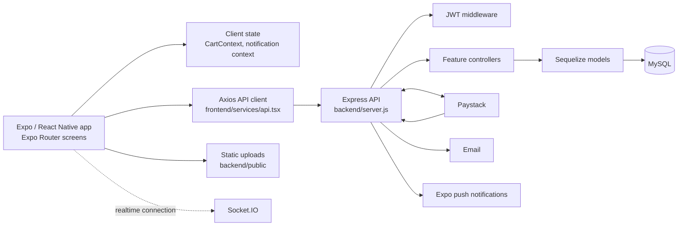

# Coolchop architecture and evolution

## Executive assessment

Coolchop has a recognizable full-stack shape: an Expo/React Native client calls a REST API hosted by Express; Sequelize models map the food-ordering domain to MySQL; and payment, email, push notifications, and Socket.IO provide integrations around that core. The code is organized by feature well enough to understand and extend.

Based on the inspected startup, authentication, customer browsing/cart, order, and payment paths, this is best treated as an **early-stage application architecture, not yet a demonstrably production-stable or scale-ready platform**. The main concern is not the use of a monolith—one service is a sensible starting point—but inconsistent boundaries and incomplete reliability controls that can cause behavior to diverge or make future change risky. This assessment is based on the paths cited below, not a complete operational or security audit.

### Specific stability signals

- **Addressed in the first hardening step:** server startup and models now share one Sequelize instance configured from the environment. Startup authenticates the database and no longer performs implicit schema synchronization. The server handles termination signals and closes its database connection.
- **Addressed in the first hardening step:** checked-in database credentials were removed from configuration; use the variables in `backend/.env.example` as a local template and inject real values through the deployment secret manager. Rotate any real credentials that may have been exposed.
- The main dish search/pagination call now agrees across `UserHome.tsx`, the API client, and the backend. Order and account-management paths have also been aligned, but older screens and unused helpers still need a full contract audit.
- **Addressed in the cart follow-up:** `CartContext` loads the authenticated cart from the backend, uses platform-appropriate token storage, and refreshes server state after mutations. Cart endpoints derive the owner from JWT claims, validate dish/quantity, and consume purchased quantities only after confirmed payment.
- **Addressed in this continuation:** public signup cannot grant administrator access. Production administrator identity is controlled by `ADMIN_USER_IDS`, and token middleware normalizes role claims against that allowlist. Customer, restaurant, and admin order access is scoped separately; restaurants can transition only their own single-restaurant orders, and customers cannot alter totals/items or cancel an order after payment initialization.
- **Addressed in the payment hardening step:** checkout initialization now requires a JWT, derives the customer/email from the verified identity, validates item IDs/quantities, calculates prices from the database, and sends only the server-calculated total to Paystack. The webhook uses timing-safe signature verification, checks currency/amount, updates payment/order/cart records in one database transaction, and suppresses duplicate success handling. Customers can also reconcile by asking the server to verify a payment reference with Paystack.
- The backend now declares Node.js `>=20 <25`, a start command, a migration/status command, and a native Node test command. Migration execution has not yet been tested against a real database.
- A migration runner is present and refuses to apply migrations to an existing non-empty database that lacks migration history. Existing installations must have their schema reviewed and migration baseline reconciled before using it.
- Focused backend tests cover JWT role normalization and migration module loading. Database transactions, real Paystack callbacks, outbox retries, and cart roundtrips still need integration coverage.
- The server's former unauthenticated GitHub webhook executed `git pull`, package installation, and a process restart through a shell command. That endpoint has been removed; deploy through a CI/CD platform with authenticated workflows instead.

These issues do not mean the app must be split into microservices. A well-structured, observable monolith backed by a properly managed database is likely the simplest next step.

## Hardening progress

The work is being applied incrementally. The changes below reduce immediate operational and access-control risks, but **do not by themselves make the system production-ready**.

### Step 1: Runtime and database foundation — implemented

- `backend/config/db.js` is now the single environment-driven database connection. It accepts `DATABASE_URL` or the `DB_*` settings documented in `backend/.env.example`, with an explicit connection pool and optional TLS configuration.
- `backend/models/index.js` and `backend/server.js` share this connection.
- Startup now requires a sufficiently long `JWT_SECRET`, a Paystack secret, an explicit admin ID allowlist, and email credentials in production; it authenticates the database before opening the HTTP listener and closes scheduled workers, sockets, and the database on SIGTERM/SIGINT.
- Production startup requires an explicit CORS origin allowlist; JSON request bodies and raw payment webhooks have size limits. JWT middleware checks bearer-header format and rejects tokens without an identity claim.
- `/health/live` reports process liveness and `/health/ready` checks database readiness. HTTP request logs include a generated request ID, method, path, status, and duration, but omit request bodies and query strings.
- Automatic `sequelize.sync()` was removed. Deployments now need an explicit migration/release step; do not deploy against an un-migrated schema.
- The unauthenticated shell-based deployment endpoint was removed. Use the hosting/CI platform's authenticated deployment integration.
- Hardcoded database credentials were removed from both the Sequelize CLI config and runtime config.

### Step 2: Request identity boundaries — substantially implemented; broader route audit remains

- Cart operations and payment initialization/reconciliation require customer identity. Restaurant menu writes and order updates require restaurant identity; restaurant order reads only include orders whose dishes all belong to that restaurant.
- Customer order reads are owner-scoped. Customers can cancel only uninitialized pending orders; restaurant status transitions are limited to `preparing → on_delivery → delivered`. Client-supplied order totals/items are not updateable.
- Administrator routes require an ID explicitly configured in `ADMIN_USER_IDS`; prior JWT role claims and client-supplied signup roles do not grant administrator access.
- Transaction routes and account listing require appropriate roles, and public restaurant profile/menu endpoints no longer use a restaurant's token as a public restaurant ID.
- Unsupported user/restaurant deletion actions and their unused API helpers were removed from the admin UI; physical deletion is deferred until a history-preserving deactivation policy is defined.
- The unused direct transaction-creation endpoint and duplicate webhook implementation were removed.
- The cart client now hydrates its state from the authenticated server cart, uses `customer_token` across web/native, and refreshes after successful writes. The older cart route was aligned with the same authenticated endpoints.
- Cart mutations validate dish IDs and quantity bounds; checkout consumes the ordered quantities after verified payment, preserving any additional quantity in the cart.
- Still required: audit legacy/unmounted controllers and remaining frontend endpoints; define a rider-specific order lifecycle and role/resource model before enabling rider order mutation.

### Step 3: Payment correctness — partially implemented

- Checkout identity and amount are now server-controlled, and payment success is signature/amount checked, transactionally recorded, and idempotent for duplicate success events.
- Authenticated `POST /api/payments/reconcile/:reference` checks order ownership, queries Paystack's verification API, validates the returned reference/amount/currency, then uses the same idempotent persistence path as the webhook. The client saves the pending reference across app restarts and only refreshes its cart after server confirmation.
- The client no longer treats the payment redirect as proof of success. Pending and failed states are reported distinctly; a new attempt is offered only after the provider reports failure.
- A durable SQL notification outbox is inserted in the same transaction as payment success. A worker claims events under row locks, retries with backoff, and moves events to a dead-letter `failed` state after ten attempts. Delivery is at-least-once, so a provider timeout can still produce a duplicate message.
- A periodic reconciler checks persisted pending references after ten minutes, retries at bounded intervals, and records success/failure/abandoned results. It checks orders for up to 48 hours; older unresolved orders need operator review. Late successful provider results can recover an order from failed/cancelled state.
- The checkout rejects a mixed-restaurant order so a restaurant can safely progress that order's lifecycle. Other restaurants' cart quantities remain available for another checkout.
- Still required: monitor webhook/reconciliation and outbox failure/dead-letter rates, and define manual payment exception handling.

### Remaining production gates

1. Configure `ADMIN_USER_IDS`, Paystack, email, CORS, database/TLS, and runtime secrets in the deployment secret manager; do not copy `.env.example` values into production.
2. Back up the target database and validate the new migration sequence in staging. For an existing database with no `SequelizeMeta` table, stop: inspect the live schema and establish a reviewed baseline before running `npm run db:migrate`.
3. Run `npm test`, then add/integrate DB-backed tests for payment races, cart consumption, authorization, outbox recovery/dead-letter handling, and migration up/down behavior.
4. Add external metrics/alerts, database backup/restore drills, deployment rollback, and provider/webhook runbooks. Readiness and structured request logs are present, but these operational controls are not.

### Backend release commands

Use Node.js 20, 22, or 24. From `backend/`, install the locked dependencies and check schema state before running migrations:

```powershell
npm ci
npm test
npm run db:migrate:status
npm run db:migrate
npm start
```

Take a tested backup first and run migrations against staging before production. The migration runner intentionally refuses an existing non-empty database without migration history; do not work around that guard by blindly inserting every migration name. Reconcile the production schema against each migration and create a reviewed baseline plan first. The server refuses startup if migration history is missing or pending.

## System at a glance



The application is currently a **single backend service organized as a modular monolith**. The route/controller/model structure is a reasonable foundation; the deployment and data boundaries should be made consistent before considering service decomposition.

## Frontend

### App shell and navigation

The app is an Expo SDK / React Native application that targets native platforms and web. Expo Router provides file-based navigation. `frontend/app/_layout.tsx` initializes the navigation stack and wraps screens in shared providers for theme, notifications, cart state, and React Native Paper.

The entry screen (`frontend/app/index.tsx`) presents customer and vendor entry points. Screens are organized under `frontend/app/`, including customer, vendor/restaurant, rider, and admin areas. `frontend/app/login.tsx` calls the shared API client, saves the returned token and role, and routes the user based on role.

### Screen and feature responsibilities

- `frontend/app/UserHome.tsx` is a customer browsing screen. It loads the signed-in user, requests location, fetches paged dishes, renders dish cards, and navigates to details/cart.
- Other route screens handle account/profile, orders, restaurants, dish management, administration, payments, and support.
- Shared components, hooks, and providers live in `frontend/components/`, `frontend/hooks/`, and `frontend/context/`.
- `frontend/context/CartContext.tsx` provides cart actions and local UI state and calls backend cart functions.

### API boundary and client state

`frontend/services/api.tsx` creates the shared Axios client and groups API calls for authentication, users, restaurants, dishes, carts, orders, and payments. Keep this as the sole HTTP boundary and make its request/response types agree with backend contracts.

The JWT is stored in Expo SecureStore on native platforms and browser `localStorage` on web. `frontend/services/authStorage.ts` centralizes token reads for screens; cart state is shared through context and hydrated from the server.

### Customer request flow

1. The customer chooses the customer path from the welcome screen and signs in.
2. The login screen calls `POST /api/user/login`; the backend checks the password and verification state, then returns a JWT and role.
3. The app stores the token and navigates to the role-specific screen.
4. `UserHome` reads the token, fetches the user profile, and optionally updates location.
5. The screen requests dishes through the API helper and allows a customer to inspect a dish or add it to the cart.
6. Cart, order, and payment screens use the same API helper to communicate with the backend.

Dish search/pagination now uses the same `(search, page, limit)` contract on the client and server. Customer restaurant profile/menu reads use public ID-based endpoints; restaurant management uses token-scoped endpoints.

## Backend

### Server and HTTP routing

`backend/server.js` creates the Express application, configures CORS and JSON parsing, serves `/public` files, mounts API routes, handles a Paystack webhook, initializes Socket.IO, starts pending-payment reconciliation and the notification outbox worker, exposes liveness/readiness checks, authenticates the shared Sequelize connection, and listens on the configured port. Schema migration is intentionally not performed automatically at application startup.

The API is grouped by feature:

| Prefix | Responsibility |
| --- | --- |
| `/api/user` | User signup, login, verification, profile and location |
| `/api/location` | Location endpoints |
| `/api/restaurant` | Restaurant accounts and restaurant/dish operations |
| `/api/orders` | Order reads and mutations |
| `/api/cart` | Cart operations |
| `/api/upload` | File/image uploads |
| `/api/ratings`, `/api/reviews` | Ratings and reviews |
| `/api/payments`, `/api/transactions` | Payment initialization and transaction operations |
| `/api/paystack/webhook` | Paystack payment event processing, mounted directly in `server.js` |

Routes delegate to feature controllers; controllers use Sequelize models to read/write data. Keep HTTP parsing, business rules, persistence, and external integrations clearly separated as the code evolves.

### Authentication and authorization

`backend/utils/tokenAuth.js` verifies bearer JWTs and normalizes customer/rider/restaurant/admin identity on `req.user`. Administrator status is derived from the server-side `ADMIN_USER_IDS` allowlist, not from a caller-supplied signup role or stale JWT claim. User login uses bcrypt password comparison and creates a time-limited JWT. Resource ownership is checked in controllers for user and restaurant order operations.

### Domain model

The Sequelize models in `backend/models/` represent:

- **User**: customer, rider, and other user roles; profile and verification data.
- **Restaurant**: restaurant account/profile data.
- **Dish**: menu item, related to a restaurant.
- **Cart**: user/dish quantities.
- **Order**: user, serialized item selection, total, status, payment reference, and last automatic reconciliation attempt. Order reads enrich stored item IDs by looking up current dish data; they are not immutable purchase-time snapshots.
- **Transaction**: payment reference/status and order/user associations.
- **NotificationOutbox**: unique payment-confirmation event, payload, retry schedule, lease, and dead-letter state.
- **Ratings and Reviews**: user feedback associated with the relevant entities.

The `backend/models/index.js` loader imports models and wires their associations. Keep the schema in migrations and ensure model associations, API contracts, and actual database constraints evolve together.

### Order, payment, and notification flow

Order endpoints are in `backend/routes/ordersRouter.js` and `backend/controllers/orderController.js`. Checkout creation is payment-initialization-only: the server prices the selected dishes and stores an order before calling Paystack. The payment-initialization route is in `backend/routes/transInitialiserRoute.js`; Paystack sends the eventual event to the webhook handler in `backend/server.js`.

On a successful Paystack event, the server verifies the request signature, finds the order by payment reference, and transactionally updates order/transaction/cart data while inserting a deduplicated outbox event. A separate worker delivers email/push notifications and retries failures. Notification delivery does not determine whether a payment is recorded as successful.

`backend/scripts/migrate.js` applies sorted migration files and records them in `SequelizeMeta`. On a non-empty database with no migration history it refuses to run rather than guessing which migrations were already applied. Run `npm run db:migrate:status` and review the target schema before deployment; production migration/baseline procedures still require staging validation.

## Runtime and deployment dependencies

The service depends on a MySQL-compatible database, Node.js, environment-specific credentials/configuration, Paystack credentials/webhooks, email provider credentials, push notification tokens, and storage for uploaded files. `backend/server.js` also opens a Socket.IO server. The inspected code creates the Socket.IO server but shows no domain event or room protocol, so it should not yet be treated as an established real-time delivery mechanism.

Uploads are served from a local backend directory in the current implementation. This is simple for one host, but multiple instances need shared object storage or another shared durable file service.

## Scale and long-term maintainability roadmap

### 1. Establish correctness and deployment safety

Prioritize these before increasing traffic:

1. **Unify database setup.** Export and reuse one Sequelize instance; configure it from environment-specific variables. Remove credentials from tracked source and configure production secrets in the deployment environment.
2. **Use migrations for schema changes.** Apply migrations as a controlled release/deploy step. Avoid model `sync()` as the production schema-management strategy.
3. **Define API contracts.** Correct mismatched arguments and response shapes; add validation for query, body, and path parameters. Generate or share typed schemas where practical.
4. **Make authorization consistent.** Apply authentication middleware at protected routes, derive user identity from the verified token, and enforce role and resource ownership.
5. **Make checkout reliable.** Validate dish quantities and prices server-side, use database transactions for order/payment records, enforce unique references, and make webhook processing safe to retry.
6. **Restore cart state from the server.** Use the authenticated cart endpoint on app startup and reconcile UI state after failed writes.
7. **Add focused tests.** Cover login/role decisions, cart ownership and totals, order creation, duplicate webhook delivery, payment failure paths, and schema migrations.

### 2. Improve operational visibility and resilience

- Add structured logs with request IDs and safe user/order correlation fields; never log passwords, tokens, or payment secrets.
- Add health/readiness endpoints that check process and database readiness.
- Track error rate, latency, database pool saturation, webhook failures, and payment-to-order state mismatches.
- Set explicit timeouts and bounded retries for external calls. Use retries only for operations that are idempotent.
- Back up MySQL and test restoration; define retention and recovery objectives.
- Centralize crash/error reporting and document on-call procedures and deployment rollback.

### 3. Scale the monolith and its data layer

- Run stateless API instances behind a reverse proxy/load balancer; keep sessions and shared state outside process memory.
- Configure a bounded database connection pool, indexes for common filters/joins, and query/pagination limits. Inspect slow queries as usage grows.
- Put uploaded images in durable object storage/CDN rather than instance-local storage.
- Move slow or retryable side effects (email, push, image processing) to a durable queue with idempotent workers.
- Use caching selectively for read-heavy, low-volatility data such as public restaurant/menu listings, with a clear invalidation policy.
- Use Socket.IO across multiple instances only with an appropriate shared adapter/pub-sub layer and a defined event contract.

### 4. Keep changes maintainable over years

- Keep a modular monolith, organized by business capability (users/auth, restaurants/catalog, cart, orders, payments, notifications) with clear dependency direction.
- Separate controllers from business use cases and external-provider adapters as complexity warrants; avoid duplicating business rules across routes.
- Maintain stable, versioned API contracts and typed request/response definitions shared or generated from a schema.
- Establish consistent naming, error handling, input validation, authorization, and logging conventions.
- Automate linting, type checking, backend/frontend tests, migration checks, and deployment validation in CI.
- Document architectural decisions when a choice has long-term consequences; revisit service decomposition only when team ownership, deployment isolation, or measured scaling limits justify it.

## Suggested target boundaries

For the next stage, retain a single deployable backend but make these responsibilities explicit:

1. **HTTP/API layer**: routing, authentication, validation, response mapping.
2. **Application/domain layer**: catalog, cart, order, payment, and account use cases.
3. **Persistence layer**: Sequelize repositories/models and versioned migrations.
4. **Integration layer**: Paystack, email, push, object storage, and queue adapters.
5. **Client layer**: Expo screens, navigation, shared state, and typed API client.

This creates seams for testing and future scaling without adding distributed-system complexity prematurely.

## Key code locations

- Frontend shell: `frontend/app/_layout.tsx`
- Customer browsing: `frontend/app/UserHome.tsx`
- Login and role routing: `frontend/app/login.tsx`
- API client: `frontend/services/api.tsx`
- Cart state: `frontend/context/CartContext.tsx`
- Backend composition: `backend/server.js`
- Database configuration: `backend/config/db.js`, `backend/config/config.json`
- Model loader and associations: `backend/models/index.js`
- Auth routes/controller: `backend/routes/authRoutes.js`, `backend/controllers/authController.js`
- JWT middleware: `backend/utils/tokenAuth.js`
- Order routes/controller: `backend/routes/ordersRouter.js`, `backend/controllers/orderController.js`
- Payment initialization: `backend/routes/transInitialiserRoute.js`
- Models: `backend/models/`
